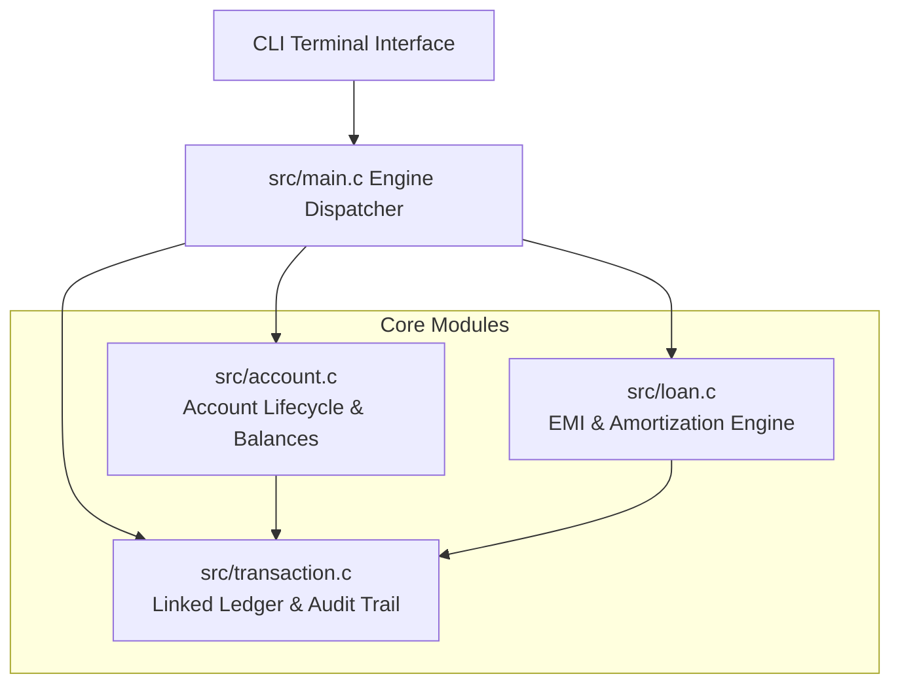

# Banking & Loan Management System in C

[](https://github.com/Udaykiranjammula-alpha/Banking-Loan-Management-System-using-c/actions)
[](https://en.wikipedia.org/wiki/C11_(C_standard_revision))
[](LICENSE)
[]()

A high-performance, memory-safe, procedural C11 banking and loan amortization engine. Engineered with modular encapsulation, linked-list transaction auditing, compound interest computation, and strict compiler compliance (`-Wall -Wextra -pedantic -std=c11`).

---

## 🏛️ System Architecture



---

## ⚡ Core Capabilities

- **Account Management**: Supports Savings, Current, and Salary account tiers with safe sequential account number generation.
- **Transactional Ledger**: In-memory linked-list transaction journal recording timestamps, operation types, deltas, and descriptions.
- **Loan & Amortization Engine**:
  - Real-time **Equated Monthly Installment (EMI)** calculation using compound interest dynamics:
    $$EMI = P \cdot r \cdot \frac{(1+r)^n}{(1+r)^n - 1}$$
    where $P$ is principal, $r$ is monthly interest rate, and $n$ is tenure in months.
  - Automated generation of month-by-month principal vs. interest breakdown tables.
- **Transfer Protocols**: Atomic inter-account balance transfers with dual-sided transaction journaling.
- **Memory Safety**: Clean heap allocation and deterministic teardown routines (`bank_free()`).

---

## 📁 Repository Structure

```
Banking-Loan-Management-System-using-c/
├── .github/
│   └── workflows/
│       └── c-build.yml          # Dual-compiler CI matrix (GCC & Clang)
├── include/
│   └── bank.h                   # Public header & data contracts
├── src/
│   ├── account.c                # Account creation, deposit, withdrawal, transfers
│   ├── loan.c                   # Loan application, EMI calculation, schedules
│   ├── transaction.c            # Linked ledger transactions & statements
│   └── main.c                   # Interactive CLI terminal interface
├── tests/
│   └── test_bank.c              # Automated unit tests with assertions
├── .gitignore                   # Excludes compiler objects and binaries
├── LICENSE                      # MIT License
├── Makefile                     # Build automation with GCC/Clang support
└── README.md                    # Project documentation
```

---

## 🛠️ Build and Execution

### Prerequisites
- GCC or Clang compiler
- GNU Make

### Build the Application
```bash
make
```
This outputs the compiled binary to `bin/banking_system`.

### Run the Application
```bash
./bin/banking_system
```

### Run Automated Unit Tests
```bash
make test
```

### Clean Build Artifacts
```bash
make clean
```

---

## 📄 License

This project is licensed under the [MIT License](LICENSE).
